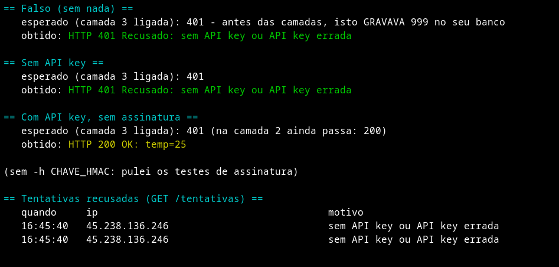
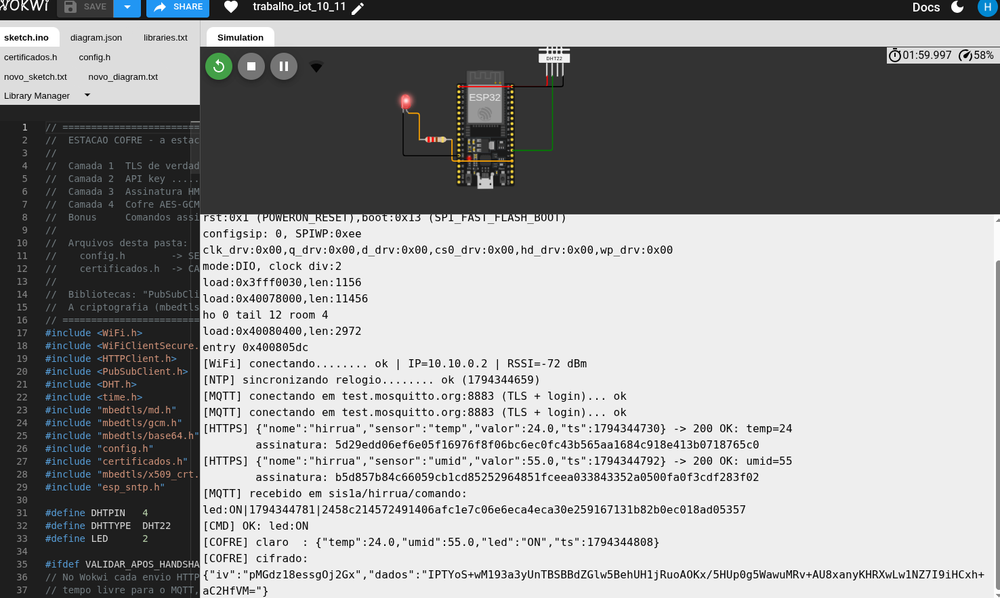
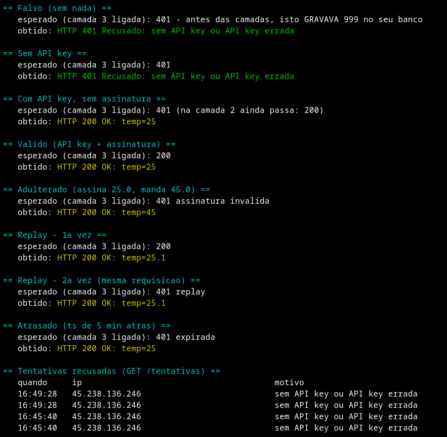
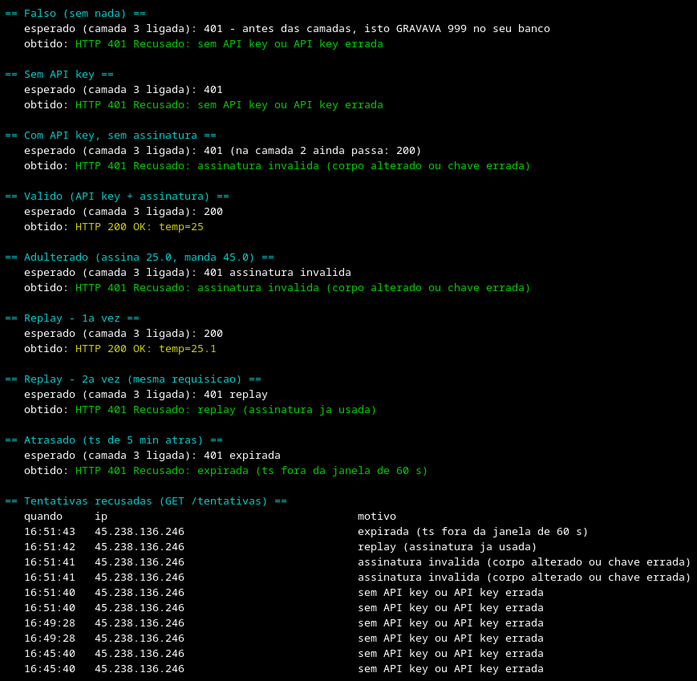
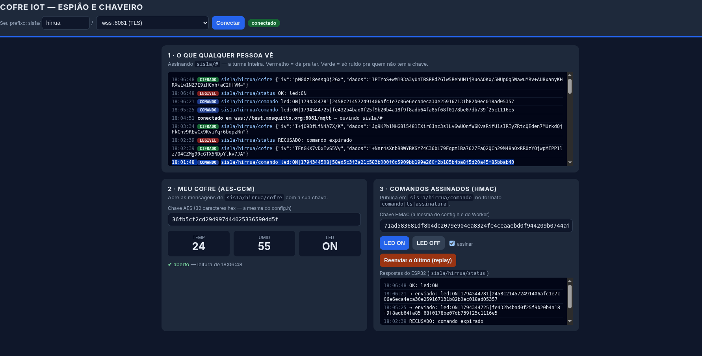

# Entrega — Estação Cofre (Segurança, Autenticação e Criptografia)

**Aluno:** Hirruá Silva
**Turma:** AMF 2026-02
**Prefixo MQTT (`NOME`):** `sis1a/hirrua/`
**Link do Worker:** `https://iot-d1.hirrua-silva20.workers.dev`
**Simulação:** Wokwi (ESP32 DevKit C v4 + DHT22 no GPIO 4 + LED no GPIO 2, Wi-Fi `Wokwi-GUEST`)

---

## Evidências (prints)

### Passo 1 — Antes de trancar
- `ataques.ps1 -Teste Falso` contra o Worker antigo → **200**, e o 999 aparecendo em `/list?sensor=temp`:

  
  

- `cofre.html` em `ws :8080`, mostrando estações da turma **LEGÍVEIS**:

  

### Passo 3 — Camada 2 (API key)
- `ataques.ps1 -Teste Todos` com `-ApiKey`: `Falso`/`SemChave` → 401, `ComChave` → 200:

  

### Passo 4 — Camada 1 (TLS)
- Serial Monitor: NTP ok, MQTT na **8885** ok, HTTPS com **200**:

  

- Serial Monitor com a **CA errada**: falha de TLS (`X509 - Certificate verification failed`):

  

### Passos 5 e 6 — Camada 3 (HMAC + anti-replay)
- **Antes** (`EXIGIR_ASSINATURA = nao`): `Adulterado`, `Replay` e `Atrasado` passando com 200:

  

- **Depois** (`EXIGIR_ASSINATURA = sim`): `Adulterado` 401, `Replay` 200 → 401, `Atrasado` 401:

  

- Lista de **tentativas recusadas** (fim do script):

  

### Passo 7 — Camada 4 (cofre AES-GCM)
- Seu tópico `/cofre` aparecendo como **CIFRADO** na seção 1:

  

- Valores **decifrados** com a chave certa (✔ aberto):

  

- Chave com 1 caractere trocado, ou chave de colega (✘ não abriu):

  

### Passo 8 — Comandos assinados
- `OK: led:ON` (assinado): 
- `RECUSADO: sem assinatura`: 
- `RECUSADO: replay (comando repetido)`: 
- `RECUSADO: assinatura invalida` (chave de colega): 

---

## O que vocês mudaram no código

- **`estacao_cofre.ino`** — `DHTTYPE` trocado para `DHT22`, porque a estação roda no Wokwi, que só oferece o DHT22. Também foi incluído o `WIFI_CANAL` opcional no `WiFi.begin()`, já que a rede `Wokwi-GUEST` fica no canal 6 e informar o canal deixa a conexão bem mais rápida (na placa física basta não definir `WIFI_CANAL` no `config.h`).
- **`certificados.h`** — o `CA_WORKER` traz as raízes das autoridades que a Cloudflare usa no `*.workers.dev` (Google Trust Services, Let's Encrypt, SSL.com e Sectigo/USERTrust), assim o ESP32 continua validando o certificado mesmo quando a Cloudflare renova o certificado com outra CA. O `CA_MOSQUITTO` é o `mosquitto.org.crt` oficial (válido até 07/06/2030).
- **`worker.js`** — usado sem alterações, com o binding `DB` apontando para o banco D1 `iot`.
- **`cofre.html`** — só o prefixo padrão trocado para `hirrua`.
- **`.gitignore`** — inclui `config.h`, então nenhuma chave vai para o repositório.

---

## Respostas

1. **No Passo 4 vocês trocaram a CA e a conexão falhou. Por que *falhar* é o comportamento correto? O que aconteceria com `setInsecure()` nessa mesma situação?**

   Falhar é o correto porque o ESP32 só deve conversar com quem prova a identidade por meio de um certificado assinado pela CA em que ele confia. Com a CA errada, o certificado do broker não fecha a cadeia e o ESP32 entende que pode estar falando com um impostor, que é exatamente o que um man-in-the-middle apresentaria. Com `setInsecure()` a conexão subiria normalmente, porque qualquer certificado seria aceito, e o canal estaria cifrado mas com um desconhecido, que poderia ler e alterar tudo sem que o dispositivo percebesse.

2. **O TLS já cifra o caminho até o broker. Por que, mesmo assim, a temperatura aparecia legível para a turma no Passo 1, e por que o AES-GCM resolve isso?**

   O TLS protege apenas o trecho entre o dispositivo e o broker, e dentro do broker a mensagem é aberta para ser distribuída a todos os assinantes do tópico. Como o `test.mosquitto.org` é público, qualquer colega que assina `sis1a/#` recebe a mensagem em claro, com ou sem TLS no caminho. O AES-GCM cifra o próprio conteúdo antes da publicação, então o broker e os outros assinantes só recebem ruído e apenas quem tem a chave AES consegue abrir. A tag de 16 bytes do GCM ainda garante que qualquer alteração no texto cifrado seja detectada.

3. **Comparem API key e assinatura HMAC: o que um atacante consegue fazer se capturar *uma* requisição de cada tipo?**

   Ao capturar uma requisição com API key, o atacante passa a ter a própria chave, porque ela viaja em todo pedido, e com isso consegue gravar quantas leituras falsas quiser até que a chave seja trocada. Ao capturar uma requisição assinada com HMAC, ele obtém somente a assinatura daquele corpo específico, que não serve para assinar outro valor. Mesmo a tentativa de reenviar a requisição idêntica é barrada pelo `ts` com janela de 60 segundos e pela tabela `assinaturas_usadas`, então o máximo que ele consegue é ser registrado em `tentativas`.

4. **O `ts` vai *dentro* do corpo assinado. O que daria errado se ele fosse num cabeçalho separado, fora da assinatura?**

   Se o `ts` ficasse fora da assinatura, o atacante poderia pegar uma requisição antiga e apenas atualizar o cabeçalho com o horário atual, e a assinatura continuaria válida porque não cobre aquele campo. A checagem de tempo deixaria de proteger contra replay, já que o carimbo poderia ser falsificado à vontade. Com o `ts` dentro do corpo, qualquer mudança no horário quebra a assinatura.

5. **Por que o Worker faz `request.text()` e assina o texto cru, em vez de fazer `request.json()` e montar o JSON de novo pra conferir?**

   A assinatura vale para os bytes exatos que o ESP32 enviou, e remontar o JSON pode mudar espaços, ordem das chaves ou a forma de escrever números (`24.0` viraria `24`, por exemplo). Qualquer diferença desse tipo geraria um HMAC diferente e o Worker recusaria leituras legítimas. Conferindo o texto cru primeiro e só depois fazendo o `JSON.parse`, o Worker compara exatamente o que foi assinado.

6. **As rotas `/list` e `/resumo` continuam abertas. Isso é problema? Para que tipo de dado (pensem no Projeto Final de vocês) passaria a ser?**

   Para temperatura e umidade de uma sala o risco é baixo, porque são dados pouco sensíveis e somente leitura. No meu Projeto Final, o armário de empréstimo de laboratório, essas rotas exporiam quem pegou cada equipamento, em que horário e quem ainda não devolveu, que são dados pessoais protegidos pela LGPD e que também revelam quando o armário está cheio ou vazio. Nesse caso a leitura também precisaria passar pelo `autenticar()` ou por um login de usuário.

7. **A chave AES foi colada à mão na página. Como resolver isso num produto com mil dispositivos vendidos?**

   O caminho é usar criptografia assimétrica para combinar a chave em vez de copiá-la. Cada dispositivo sai da fábrica com um par de chaves próprio (ou um certificado único gravado em um elemento seguro), e no primeiro contato faz uma troca do tipo ECDH com o servidor ou com o aplicativo do dono, gerando uma chave AES de sessão que nunca trafega pela rede. Assim cada aparelho tem a sua chave, um vazamento afeta só um dispositivo e a chave pode ser revogada ou trocada de forma remota.

8. **No seu Projeto Final, qual é o pior estrago que alguém faria sem as camadas de hoje? Qual camada vocês vão levar pra lá, e por quê?**

   No armário de empréstimo o pior estrago seria alguém publicar um comando de abertura no tópico do armário e retirar equipamentos sem registro, ou gravar devoluções falsas no banco para apagar a responsabilidade de quem pegou o equipamento. Vou levar o comando assinado com `comando|ts|assinatura` para a fechadura, porque é ele que impede abrir o armário com uma mensagem forjada ou repetida. Também vou levar o `setCACert()` em todas as conexões e o `autenticar()` com HMAC na rota que registra retiradas e devoluções, para que o histórico seja confiável, mantendo o `config.h` fora do GitHub.

---

**Entrega:** este `ENTREGA.md` preenchido, `estacao_cofre.ino`, `worker.js` e `certificados.h`, no
GitHub de cada um, **sem o `config.h`**.
